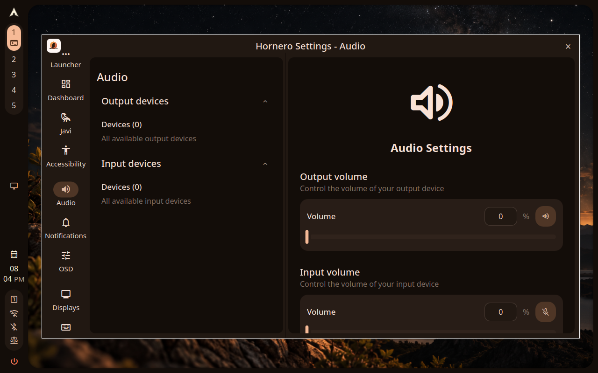

# Control Center audio on Preview 29

This capture comes from the passing `personalization/controlcenter-panel-matrix`
run `20261024T200300Z-personalization-controlcenter-panel-matrix-1`. The run
visited the Javi destination and then Audio through the Settings search UI; it
finished in 145.623 seconds with all 54 actions and proof checks passing.

| Provenance | Value |
|---|---|
| Shell | `85e35a3a9db252d20a64b02096b7f3432152c30e` |
| Config | `76a552f7ec56f00ed52e122150f27639a3a8d70a` |
| horneroctl | `horneroctl-v0.2.0-preview29` (`028a52c`) |
| QA image | `qa-display-preview29-20261024` |
| Environment | QEMU/KVM, Hyprland, 1280×800, one output |

The Audio page presents general output and input volume controls. This run's
image showed zero input and output devices. The capture does not establish
device support or audio health; it does show the existing Control Center
surface that Studio audio work should reuse and extend rather than duplicate.

`010-controlcenter-audio.json` preserves the screenshot hash, run ID, capture
time, product pins, and environment. `run.json` preserves the scenario and
image provenance; `result.json` records the verdict and run summary. The full
local bundle remains under
`~/.local/share/hornero/qa/runs/20261024T200300Z-personalization-controlcenter-panel-matrix-1/`.
